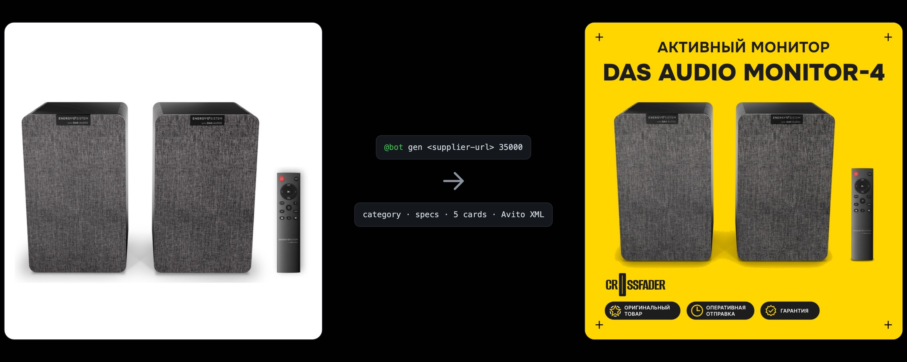

# crossfader-images-ai-bot

> Supplier link in, ready marketplace listing out: category, specs, five branded photos and an Avito XML feed.



<br>
<h5 align="center">
  <a href="#how-it-works">How it works</a> ⁃
  <a href="#getting-started">Getting started</a> ⁃
  <a href="#deployment">Deployment</a>
</h5>
<br>

Telegram bot for a music store with about 2,000 active listings on Avito. The manager drops a supplier URL and a price into the group chat. The bot parses the product page, picks the category, writes the description, generates five photos in the store's style and publishes everything to Avito through the feed.

## How it works

```
@bot gen <supplier-url> [avito-url] <price>
        │
        ▼
  parse page ──▶ category + specs ──▶ description ──▶ 5 cards ──▶ preview in chat
                                                                      │
  @bot publish ◀──────────────────────────────────────────────────────┘
        │
        ▼
  XML feed ──▶ S3 ──▶ Avito autoload
```

| Command | What it does |
|---|---|
| `@bot gen <url> [avito-url] <price>` | Parse the supplier page and generate the listing. Several links per message are fine. |
| `@bot get <id>` | Show the generated listing again |
| `@bot drop <id>` | Remove a listing from the publish queue |
| `@bot publish` | Build the XML feed, upload it and trigger Avito autoload |

## Tech stack

| | |
|---|---|
| Runtime | Node 22, TypeScript, pnpm |
| Bot | grammY, PostgreSQL (`pg`) |
| AI | Gemini (Nano Banana for images, Gemma for text and vision) |
| Parsing and rendering | Playwright |
| Delivery | Avito API, S3 |

## Project structure

```
src/
  Bot.ts              orchestration: queue, states, publish
  TelegramGateway/    commands, messages, buttons
  Parser/             supplier page → product data + photo
  AI/                 Gemini / Gemma clients, classification, colors
  Image/              five card generators, prompts, graphics
  XMLFeedAvito/       category lookup, description, XML, S3, Avito API
tests/                e2e tests on real models and real pages
```

## Getting started

```bash
pnpm install
pnpm dev
```

```bash
pnpm test
```

## Deployment

```bash
docker build -t serega-bot-images:<version> .
VERSION=<version> docker compose up -d
```
